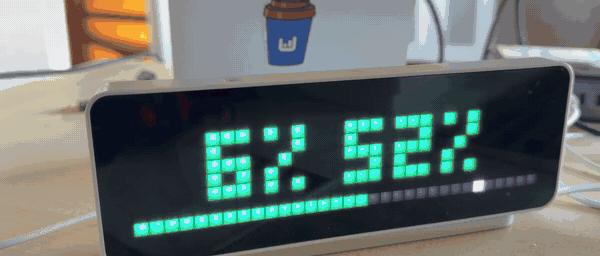

# claude-meter

Claude Code usage limits and session state on an [AWTRIX 3](https://blueforcer.github.io/awtrix3/) pixel clock (Ulanzi TC001).



- **`7% 49%`**: the 5 hour window and the week. The 5 hour number is green under 50%, yellow under 80%, red above.
- **Bottom row**: weekly usage as a bar. The white pixel is how much of the week has passed, so you can see if you are ahead of your budget. The week colour follows that pace: green while usage stays behind time, yellow when it gets ahead, red when it is more than 15 points ahead or above 90%.
- **Top right indicator**: all Claude Code sessions together. Blinking red: one is waiting for you (a permission prompt or a question). Green: something is working. Off: idle.
- **`WAIT <project>`** pops up once with a short beep when a session starts waiting, with the name of its folder.

No API keys and no requests to Anthropic. Claude Code already passes `rate_limits` to the status line command, and hooks report what each session is doing. Everything stays on your machine and the clock on your LAN. Python 3 standard library only.

Inspired by [@osk2](https://x.com/osk2)'s AWTRIX status light for Codex.

## How it works

```
Claude Code ── status line JSON ──> save_limits.py ──> ~/.claude/statusline-limits-cache.json ─┐
            └─ hooks ─────────────> agent_state_hook.py ──> ~/.claude/agent-state/*.json ──────┤
                                                                                              v
                                                          awtrix_limits.py (daemon) ── HTTP ──> AWTRIX
```

- `save_limits.py` is a status line command. It saves `rate_limits` and prints `5h 7% · week 49%`, or runs your own status line and prints its output instead.
- `agent_state_hook.py` writes one small file per session: `run`, `wait`, `done`, or removes it on `end`.
- `awtrix_limits.py` checks those files every 2 seconds and pushes a custom app, the indicator and notifications to the clock. The frame has a 15 minute lifetime, so it disappears by itself if the daemon stops.

Interrupting Claude or rejecting a prompt fires no hook, so a `wait` would stick. The daemon handles it by checking the session transcript: any new record after the wait means you already answered.

## Setup

1. **Status line.** In `~/.claude/settings.json`:

   ```json
   "statusLine": {"type": "command", "command": "python3 /path/to/claude-meter/save_limits.py"}
   ```

   Already have a status line? Keep it by passing it as arguments:

   ```json
   "statusLine": {"type": "command", "command": "python3 /path/to/claude-meter/save_limits.py python3 /path/to/your_statusline.py"}
   ```

2. **Hooks**, in the same file (merge with any hooks you already have):

   ```json
   "hooks": {
     "UserPromptSubmit": [{"hooks": [{"type": "command", "command": "python3 /path/to/claude-meter/agent_state_hook.py run", "async": true}]}],
     "PostToolUse": [{"hooks": [{"type": "command", "command": "python3 /path/to/claude-meter/agent_state_hook.py run", "async": true}]}],
     "PreToolUse": [{"matcher": "AskUserQuestion", "hooks": [{"type": "command", "command": "python3 /path/to/claude-meter/agent_state_hook.py wait", "async": true}]}],
     "Notification": [
       {"matcher": "permission_prompt|elicitation_dialog|elicitation_url_dialog", "hooks": [{"type": "command", "command": "python3 /path/to/claude-meter/agent_state_hook.py wait", "async": true}]},
       {"matcher": "idle_prompt", "hooks": [{"type": "command", "command": "python3 /path/to/claude-meter/agent_state_hook.py done", "async": true}]}
     ],
     "Stop": [{"hooks": [{"type": "command", "command": "python3 /path/to/claude-meter/agent_state_hook.py done", "async": true}]}],
     "StopFailure": [{"hooks": [{"type": "command", "command": "python3 /path/to/claude-meter/agent_state_hook.py done", "async": true}]}],
     "SessionEnd": [{"hooks": [{"type": "command", "command": "python3 /path/to/claude-meter/agent_state_hook.py end", "async": true}]}]
   }
   ```

3. **Try it once:**

   ```sh
   AWTRIX_HOST=192.168.1.50 python3 awtrix_limits.py --once
   ```

4. **Run it in the background** (macOS):

   ```sh
   sed -e "s|__DIR__|$PWD|" -e "s|__AWTRIX_HOST__|192.168.1.50|" \
     com.tolixx.claude-meter.plist > ~/Library/LaunchAgents/com.tolixx.claude-meter.plist
   launchctl load ~/Library/LaunchAgents/com.tolixx.claude-meter.plist
   tail -f /tmp/claude-meter.log
   ```

   macOS asks once for Local Network access for Python. On Linux, any way to keep a process running works (a systemd user unit, tmux).

## Settings

Environment variables for `awtrix_limits.py`:

| Variable | Default | |
|---|---|---|
| `AWTRIX_HOST` | (required) | IP or hostname of the clock |
| `AWTRIX_APP` | `claude` | name of the custom app on the clock |
| `AWTRIX_ICON` | none | icon to show next to the numbers; it must already be on the clock |
| `AWTRIX_WAIT_SOUND` | a short two-note beep | [RTTTL](https://blueforcer.github.io/awtrix3/#/api?id=custom-apps-and-notifications) melody the clock's buzzer plays with `WAIT`; empty for silence. The clock's own sound setting must be on |
| `CLAUDE_LIMITS_CACHE` | `~/.claude/statusline-limits-cache.json` | also read by `save_limits.py` |

A fresh session has no `rate_limits` until its first request, so the cache keeps the last values. Limits belong to the account, so they are still right; a window that has already reset counts as 0%.

## Handheld remote (optional)

An Anbernic RG40XX H on muOS shows the same sessions and limits, and answers permission prompts: A allows, B denies.

```
Claude Code ── PermissionRequest hook ──> permission_hook.py ──> ~/.claude/agent-remote/pending/
                                                ^                          │
                                     decisions/ │                          v
                                                └──── remote_server.py <── HTTP (LAN, token) ── handheld
```

- `remote_server.py` serves `GET /state` (sessions, pending prompts, limits) and `POST /decide` on port 8787. Every request needs the `X-Token` header; the token is created on the first run in `~/.claude/agent-remote/token`.
- `permission_hook.py` waits up to 90 s for a button, but only while the handheld is polling. With the app closed it returns at once and you get the normal prompt in the terminal. It never approves anything by itself: no answer, no decision.
- `handheld/agent_remote.py` is Python 3 standard library only. It draws with the SDL2 and SDL2_ttf libraries muOS already ships, through ctypes.

Approving a prompt runs a command on your Mac, so keep the token secret and the port on your LAN.

1. **Server** (macOS):

   ```sh
   sed -e "s|__DIR__|$PWD|g" com.tolixx.claude-remote.plist > ~/Library/LaunchAgents/com.tolixx.claude-remote.plist
   launchctl load ~/Library/LaunchAgents/com.tolixx.claude-remote.plist
   python3 remote_server.py --token
   ```

2. **Hook**, in `~/.claude/settings.json` (not async, it has to wait for the answer):

   ```json
   "PermissionRequest": [{"hooks": [{"type": "command", "command": "python3 /path/to/claude-meter/permission_hook.py", "timeout": 120}]}]
   ```

3. **Handheld.** Turn on Wi-Fi and SSH in muOS (Configuration → Web Services), then:

   ```sh
   ssh root@<handheld> mkdir -p /mnt/mmc/MUOS/application/.agentremote
   scp handheld/agent_remote.py root@<handheld>:/mnt/mmc/MUOS/application/.agentremote/
   scp "handheld/Agent Remote.sh" root@<handheld>:/mnt/mmc/MUOS/application/
   echo '{"server": "http://<mac>:8787", "token": "<token>"}' | ssh root@<handheld> 'cat > /mnt/mmc/MUOS/application/.agentremote/config.json'
   ```

   Then open Applications → Agent Remote. MENU or SELECT+START quits. Errors go to `.agentremote/log.txt`.

## License

MIT
